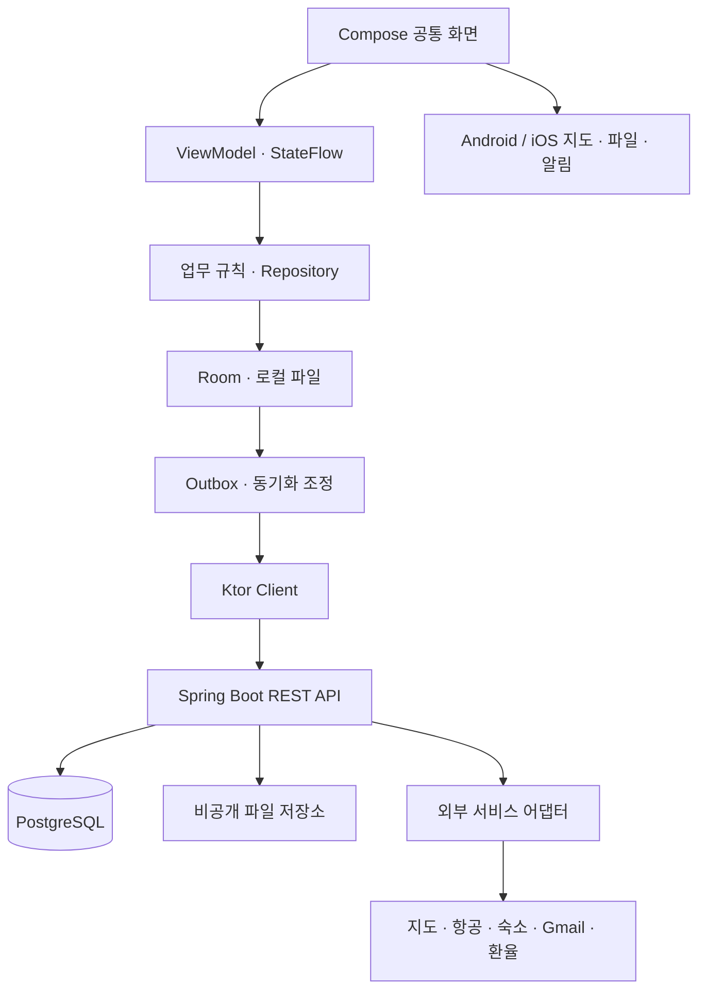
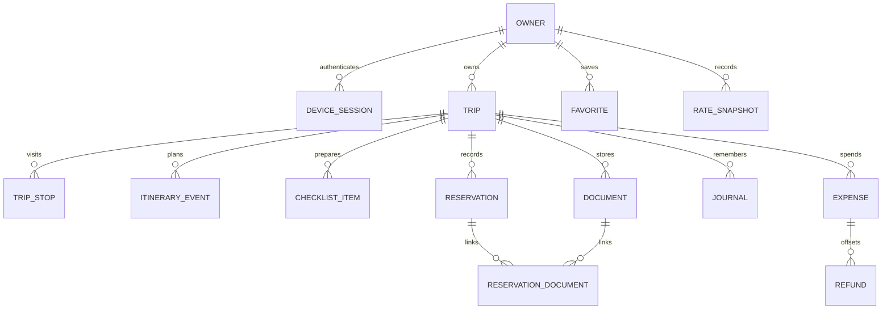

# 개인 여행 공간 — 시스템·데이터·API 설계 v2.0

작성일: 2026-11-01 · 설계 제안이며 구현 결과가 아님

## 1. 아키텍처

하나의 앱 코드베이스에서 Android·iOS를 지원한다. 서버는 도메인별 패키지로 나눈 단일 Spring Boot 애플리케이션으로 배포한다. 클라이언트는 서버 DB에 직접 접속하지 않는다.



### 앱 책임

공통 UI·상태·입력 검증·로컬 저장·API 통신·동기화 규칙을 공유한다. 지도 SDK 뷰, 보안 저장소, 사진·문서 선택, 파일 미리보기, 알림 예약은 플랫폼별 구현을 둔다. 공통 코드가 Java 전용 API나 Android Context에 의존하지 않게 한다.

화면은 로컬 DB를 관찰한다. 네트워크 결과는 DB에 반영한 후 화면에 나타난다. 공통 검증은 빠른 피드백 용도이며 서버 검증을 생략하지 않는다. ViewModel은 화면 상태를 관리하고, Repository는 저장과 조회를 책임진다. 복잡한 환산·동기화 로직만 별도 서비스로 추출한다.

### 서버 책임

인증·소유권·정합성·중복 방지·동기화 변경 로그·파일 접근·외부 비밀키를 관리한다. 서버 패키지는 auth, trip, itinerary, checklist, reservation, budget, journal, document, sync, integration, backup으로 구분한다. 초기부터 마이크로서비스·메시지 브로커를 도입하지 않는다. 분리 배포가 실제로 필요한 부하와 운영 이유가 생기면 재검토한다.

### 제안 디렉토리

```text
travel-app/
├── app/                     # 독립 Gradle 프로젝트
│   ├── composeApp/          # commonMain, androidMain, iosMain
│   ├── iosApp/              # Xcode 진입점·서명 설정
│   └── gradle/              # wrapper·버전 카탈로그
├── backend/                 # 독립 Spring Boot Gradle 프로젝트
├── db/                      # SQL 마이그레이션·백업 운영 문서
├── contracts/               # OpenAPI v2, JSON 예시·계약 테스트 자료
├── docs/                    # PRD·설계·ADR·검증 기록
└── infra/                   # 개발 Compose·배포 설정
```

이는 논리 구조이며 실제 생성기의 모듈 이름은 호환 버전에 맞춘다. `db/`의 SQL을 서버 배포에 포함하는 단일 경로를 정해 마이그레이션 사본이 갈라지지 않게 한다. 클라이언트 모델, 서버 JPA 엔티티, 공개 API DTO는 각각 분리한다.

## 2. 데이터 모델



| 엔티티 | 주요 필드·규칙 |
|---|---|
| Owner | id, username, passwordHash, createdAt; 초기 한 계정. 모든 데이터 조회는 ownerId를 검증 |
| DeviceSession | id, ownerId, deviceLabel, refreshHash, expiresAt, revokedAt; 원본 갱신 토큰 저장 금지 |
| Trip | UUID, ownerId, title, startDate, endDate, baseCurrency, budgetAmount, status, version, deletedAt |
| TripStop | tripId, city, countryCode, timeZone, startDate, endDate, orderIndex |
| ItineraryEvent | tripId, stopId nullable, title, category, localDate, startInstant/endInstant nullable, timeZone, placeId nullable, memo |
| Place | ownerId, provider, providerPlaceId nullable, name, latitude/longitude nullable, sourceUrl; 제공자 데이터 저장 조건 준수 |
| ChecklistItem | tripId, title, category, done, dueDate nullable, templateKey nullable |
| Reservation | tripId, type, source(manual/provider), provider, confirmationCode, status, departure/arrival zone, instants nullable, cancelDeadline |
| Document | tripId, storageKey, originalName, MIME, byteSize, checksum, lifecycleState; 로컬 URI를 서버에 저장하지 않음 |
| ReservationDocument | reservationId, documentId; 같은 소유자·여행의 파일만 연결 |
| Expense | tripId, kind(planned/actual), amount, currency, date, category, convertedAmount nullable, rateSnapshotId nullable, settledAmount nullable |
| Refund | originalExpenseId, amount, currency, date, appliedRate; 원지출 수정 대신 환불 이력 |
| RateSnapshot | baseCurrency, quoteCurrency, rateDecimal, observedAt, source, manual, sourceUrl nullable |
| Journal | tripId, localDate, title, body; 사진 연결은 별도 테이블 |
| Favorite | ownerId, tripId nullable, kind, title, url, provider, memo |
| FareObservation | ownerId, cohortKey, offerKey, price, currency, observedAt, source, usagePermissionRef |
| ChangeLog | ownerId, sequence, entityType, entityId, operation, version, changedAt; 동기화 커서 원천 |
| MutationReceipt | ownerId, operationId, requestHash, result; 동일 요청 재처리 방지 |

수정 가능한 주요 레코드는 version과 updatedAt을 갖는다. 서버 기준 시간으로 갱신하고, 기기 시각을 충돌 우선순위로 사용하지 않는다. 외래키·필수값·날짜·금액 범위를 서버와 DB에서 보장한다. 필요한 인덱스는 ownerId, tripId, 날짜·정렬키, 변경 sequence이며 실제 조회계획으로 조정한다.

## 3. 날짜·시간·금액 규칙

- 여행 기간과 날짜만 있는 준비 기한은 LocalDate로 저장한다.
- 시각이 정해진 일정은 UTC instant와 IANA 시간대, 필요 시 원래 현지 입력을 보존한다.
- 항공편 출발과 도착은 각각의 공항 시간대를 가진다. 날짜 변경선을 넘는 경우 현지 날짜의 크기로 검증하지 않고 instant로 비교한다.
- DST로 존재하지 않는 시각은 오류 안내, 두 번 존재하는 시각은 오프셋을 선택하게 한다. 시간 미정은 00:00으로 대신하지 않는다.
- 금액·환율은 v2 JSON에서 십진 문자열, 서버는 BigDecimal, PostgreSQL은 NUMERIC을 사용한다. NUMERIC은 정확한 십진 수 표현을 지원한다. [PostgreSQL 공식 문서](https://www.postgresql.org/docs/current/datatype-numeric.html)
- 클라이언트는 원금액을 문자열 또는 검증된 십진 타입으로 보존한다. 공통 Kotlin 코드에서 JVM 전용 BigDecimal을 직접 쓰지 않는다. 정밀 계산은 서버가 기준이며 오프라인 합계는 검증한 공통 십진 연산 구현을 선정한 뒤 제공한다.
- 통화 자릿수는 통화 메타데이터를 따르고 환산 마지막 단계에서 반올림한다. 원금액·환율·반올림 규칙을 기록한다. 환율 누락은 0으로 취급하지 않는다.

## 4. 오프라인 및 동기화 프로토콜

오프라인 지원은 ‘앱 화면이 뜸’과 ‘필요한 데이터·파일이 저장됨’을 따로 확인한다. 화면은 캐시된 데이터의 마지막 동기화 시각과 미전송 건수를 표시한다. 앱 내부 데이터 쓰기에는 다음 프로토콜을 사용한다. 외부 결제·예약 요청은 이 큐에 넣지 않는다.

### 로컬 편집

1. 클라이언트가 entity UUID와 operation UUID를 생성한다.
2. Room 트랜잭션 하나에서 로컬 레코드 변경과 Outbox 작업을 저장한다.
3. 상태는 pending으로 표시한다. 앱이 종료되어도 작업이 남는다.
4. 연결·인증 가능 시 엔티티별 순서로 전송한다. 새 여행 생성은 자식 일정 생성보다 먼저 처리한다.
5. 서버는 operationId 중복, ownerId, baseVersion을 검증한다.
6. 서버 데이터·ChangeLog·MutationReceipt를 한 트랜잭션으로 커밋한다.
7. 앱은 응답 버전 반영과 Outbox 완료 처리를 원자적으로 수행한다.

한 레코드에 여러 로컬 수정이 쌓인 경우 전송 중이 아닌 후속 수정은 합칠 수 있다. 첫 응답 이후 남은 변경을 재적용하고 최신 baseVersion으로 다음 작업을 준비한다. 서버 응답으로 아직 미전송인 로컬 편집을 덮어쓰지 않는다.

### 내려받기와 충돌

변경분은 owner별 단조 증가 sequence 커서로 페이지 조회한다. 페이지 적용과 커서 저장은 로컬 트랜잭션 하나로 수행한다. 미전송 변경이 없는 레코드만 바로 갱신한다. 미전송 변경이 있으면 서버 사본을 별도로 보관한다.

버전이 다르면 서버가 409와 현재 사본을 반환한다. 기본 정책은 자동 최종쓰기 승리 방식 대신 ‘내 변경/서버 변경’ 비교다. 사용자가 선택한 내용을 최신 버전에 다시 적용하며, 그동안 또 바뀌면 다시 충돌 처리한다. 서로 독립적인 체크 항목은 다른 레코드이므로 별개로 동기화된다.

삭제는 tombstone으로 전파한다. 다른 기기에서 삭제된 항목의 오프라인 수정은 자동 부활시키지 않고 보관된 초안으로 제시한다. 여행 삭제 시 자식 변경도 거절한다. 오래된 커서의 tombstone이 정리된 경우 서버는 CURSOR_EXPIRED를 반환하고 전체 스냅샷 재동기화를 요구한다. 재동기화 전 미전송 초안은 별도로 보존한다.

재시도는 일시적 네트워크·5xx·429에 지수 백오프와 지터를 적용하고 Retry-After를 존중한다. 401은 토큰 갱신/재로그인, 409는 충돌 해결, 유효성 오류는 사용자 수정이 필요하다. 동일 operationId에 다른 요청 본문을 보내면 거절한다.

### 동기화 경계

거래 상태, 외부 가격, 지도 응답은 일반 로컬 편집 대상으로 두지 않는다. 파일은 메타데이터와 별도 업로드 상태를 관리하고 바이트 전송 완료·체크섬 확인 후 사용 가능 상태로 전환한다. 오프라인 대기 파일은 앱 전용 저장소에 복사해 원본 선택 권한 만료에 대비한다.

## 5. API v2 제안

기존 `/api/v1`의 쿠키·workspace 계약과 명시적으로 분리한다. 새 앱은 `/api/v2`를 사용하며 OpenAPI를 기준으로 계약 테스트를 수행한다.

| Method · Path | 용도 |
|---|---|
| POST /auth/login | 소유자 인증, access·refresh 토큰과 만료 시각 반환 |
| POST /auth/refresh | 갱신 토큰 회전; 동시 갱신은 클라이언트에서 하나로 합침 |
| POST /auth/logout | 현재 기기 세션 폐기 |
| GET /auth/devices | 기기 세션 목록 |
| DELETE /auth/devices/{id} | 지정 기기 세션 폐기 |
| GET /trips?cursor=... | 여행 페이지 조회 |
| GET /trips/{id}/snapshot | 해당 여행의 서버 기준 스냅샷 |
| POST /sync/mutations | 일정·여행 등 도메인 작업을 버전·중복 검증 후 적용 |
| GET /sync/changes?cursor=... | 소유자 변경분 및 다음 커서 |
| POST /trips/{id}/documents | multipart 파일 업로드; operationId로 중복 방지 |
| GET /documents/{id}/content | 소유자 확인 후 파일 반환 |
| DELETE /documents/{id} | 파일 삭제를 도메인 변경으로 기록 |
| POST /backups / POST /restores | 백업·검증된 복원 작업 생성, 작업 상태 조회 제공 |
| GET /integrations | 서비스별 capability·상태·실패 이유 |
| POST /search/flights /search/stays | 조건별 외부 검색, 출처·조회 시각·유효기간 |
| POST /booking-quotes | 예약 가격·조건 재확인 |
| POST /orders | 내부 예약 확정 요청; 별도 멱등키 필수 |
| GET /orders/{id} | 거래 결과 재조회 |
| POST /orders/{id}/cancellation-quotes | 취소 가능성·수수료·환불 예상액 확인 |
| POST /orders/{id}/cancel | 확인한 조건에 따른 취소 요청 |
| POST /gmail/import-preview /import-confirm | 선택 메일 파싱과 사용자 확인 후 저장 |

예시 도메인 작업:

```json
{
  "operationId": "UUID",
  "entityType": "expense",
  "entityId": "UUID",
  "action": "create",
  "baseVersion": 0,
  "payload": {"tripId": "UUID", "amount": "1500", "currency": "JPY", "kind": "actual"}
}
```

일괄 작업은 항목별 결과를 반환하며 배치 전체 원자성을 암묵적으로 약속하지 않는다. 의존 작업은 선행 성공 후 전송한다. 오류 형태는 `{code,message,fieldErrors,requestId,retryable}`로 통일한다. conflict 응답에는 serverVersion과 serverEntity를 추가한다. 서버 내부 예외·자격 증명은 노출하지 않는다.

## 6. 모바일 인증·개인정보

단일 소유자 조건에서 Spring Security와 서버 저장형 opaque bearer token을 제안한다. JWT의 분산 검증 이점보다 간단한 기기별 폐기가 중요하기 때문이다. access token은 짧은 수명, refresh token은 기기별 긴 수명과 회전을 적용한다. 제안 기본값은 15분/30일이며 실제 사용성과 위협 모델에 따라 조정한다.

토큰은 충분한 난수로 생성하고 서버에는 해시를 저장한다. access token은 기본적으로 메모리, refresh token은 iOS Keychain 또는 Android Keystore로 보호한 저장소에 보관한다. Keystore 자체가 임의 문자열 저장소라는 의미는 아니다. 비밀번호는 Spring PasswordEncoder의 적응형 해시를 사용한다. 온라인 비밀번호 변경/전체 로그아웃 시 관련 세션을 폐기한다.

앱 전용 Bearer 경로는 브라우저의 자동 쿠키 인증을 허용하지 않는다. 기존 웹 경로를 남기면 쿠키·CSRF 정책도 별도로 유지한다. 로그인 시도 제한과 실패 관측을 둔다. 공개 로그인으로 확대하면 외부 OIDC 제공자 및 Authorization Code + PKCE 도입을 재검토한다.

최초 로그인은 온라인에서 수행한다. 이미 로그인해 기기에 저장한 자료는 오프라인에서 열 수 있도록 하되 앱 잠금과 OS 보안 기능을 활용한다. 원격 폐기는 오프라인 기기의 저장 데이터를 즉시 삭제하지 못한다. 재연결 시 인증 거절과 로컬 자료 정리를 수행한다. 로그아웃 때 미전송 데이터가 있으면 동기화·내보내기·명시적 삭제 선택을 제공하고, 완료된 로그아웃은 토큰과 사용자 로컬 캐시를 제거한다.

서버·앱 로그에서 예약번호, 이메일 본문, 파일 내용, 토큰은 제외한다. 위치 권한은 현재 위치 기능을 쓸 때만 요청한다. 사진의 위치 메타데이터는 업로드 전 제거를 기본 제안으로 둔다.

## 7. 파일·백업·알림

파일은 초기 로컬 서버의 비공개 디렉토리에 보관하고 운영 배포에서 S3 호환 객체 저장소로 옮길 수 있게 Storage 인터페이스를 둔다. DB에는 파일 메타데이터만 둔다. 확장자·MIME·파일 서명을 검사하고 업로드 완료 전 임시 파일을 노출하지 않는다. 크기·유형 기준은 운영 설정으로 관리하며 사용자 요구를 임의로 줄이는 용도로 쓰지 않는다.

DB 삭제 커밋 후 파일 삭제 작업을 실행하고 실패 시 재시도한다. DB 롤백 전에 물리 파일을 지우지 않는다. 전체 백업은 포맷 버전·manifest·체크섬·참조 무결성을 검증한다. 복원 시 기기별 syncEpoch를 변경해 오래된 커서와 대기 작업을 그대로 재적용하지 않게 하고, 대기 초안은 별도 복구 대상으로 남긴다. 토큰·비밀번호·공급사 자격 증명은 백업에서 제외한다. 내보낸 여행 자료에는 개인정보가 포함되므로 저장 위치를 사용자가 선택하게 한다.

출발·준비·취소 마감은 각 기기의 OS 로컬 알림으로 예약하고 앱 내 알림함도 제공한다. 알림 권한 거부와 OS 지연 가능성을 UI에 반영한다. 푸시 알림은 항공편 변경 등 서버 발생 이벤트를 연결할 때 도입한다. 기기별 시간대 변경·예약 수정·삭제 시 예약된 알림도 갱신한다.

## 8. 외부 연동 및 거래 상태

서비스별로 검색, 가격 재확인, 예약, 결제, 취소, 환불, 저장 허용 여부를 각각 관리한다. ‘연결됨’ 하나로 모든 기능 지원을 표현하지 않는다. ChatGPT 플러그인 연결은 자체 앱의 API 이용 계약을 뜻하지 않는다.

Booking.com은 제휴·계약·인증 요건이 있고 Orders API는 지원 여행 서비스의 예약 관리 기능을 제공한다. Skyscanner는 API 신청 경로를 제공한다. 실제 계정의 승인과 사용 범위는 별도 확인 대상이다. [Booking 요건](https://developers.booking.com/demand/docs/getting-started/prerequisites), [Orders](https://developers.booking.com/demand/docs/orders-api/overview), [Skyscanner API](https://www.partners.skyscanner.net/product/travel-api)

토스뱅크 실제 환전 환율의 외부 앱용 공식 API 이용 조건은 이번 조사에서도 확보하지 못했다. 따라서 ‘API가 없다’고 단정하지 않고, 수동 환율을 기본으로 두며 공식 연동 가능성을 남긴다. 토스증권의 환율 API와 토스뱅크 환전 환율을 같은 값으로 간주하지 않는다.

Gmail 가져오기는 선택 메일 → 파싱 결과 검토 → 확정 저장 순서다. 읽기 권한도 제한 범위 분류와 검증 요건을 확인해야 한다. 출처 messageId·첨부파일 해시로 중복을 검사하고 자동 메일 발송은 하지 않는다. [Gmail 권한 문서](https://developers.google.com/workspace/gmail/api/auth/scopes)

### 예약 처리

`draft → quoted → confirming → confirmed / failed / unknown`으로 관리한다. 공급사 응답이 끊기면 unknown으로 두고 공급사 참조키로 재조회한다. 결과 불명 상태에서 무조건 재결제하지 않는다. 취소는 `cancellation_requested → cancelled / cancellation_failed / unknown`으로 구분하고 환불은 별도 상태로 추적한다. 실제 공급사 상태를 내부 상태로 매핑하고 공급사 이벤트·재조회 결과의 중복과 순서 역전을 처리한다.

### 가격 통계

코호트는 출발·도착, 여행 날짜, 인원, 좌석, 수하물, 경유 조건, 통화, 세금 포함 기준을 포함한다. 서로 다른 조건을 하나의 평균으로 묶지 않는다. 기본 최근 30일의 ‘관측일별 평균 가격의 평균’과 ‘관측일별 최저가의 평균’을 제공한다. 데이터가 있는 날만 분모에 포함하고 관측일 수·견적 수·수집 출처를 표시한다. 일별 수집 빈도 차이가 전체 평균을 왜곡하지 않게 한다. 공급사의 데이터 보관 허용 조건을 충족한 관측만 저장한다.

## 9. 기존 구현 전환 계획

1. 기존 웹 데이터와 첨부파일을 백업하고 스키마·API·테스트를 조사한다.
2. 기획 문서를 v2 기준으로 고정하고 앱 최소 통합 흐름을 새로 만든다.
3. Spring 도메인 검증과 DB 구조는 검토 후 재사용하되 모바일 인증·sync·십진 문자열 API는 새로 추가한다.
4. React 화면은 앱 화면으로 다시 작성한다. 웹의 화면 구조와 검증 사례는 참고 자료로 사용한다.
5. 기존 금액·시간 데이터 변환은 dry run으로 건수·합계·참조 무결성을 비교하고 변환 보고서를 남긴다.
6. 두 플랫폼과 실제 서버 통합을 검증한 후 새 앱을 일상 사용한다. 안정화 전 기존 데이터의 원본 백업을 유지한다.

## 10. 테스트·운영 계획

공통 테스트: 날짜·환산·중복 처리·충돌·삭제·재시도. 서버 테스트: 실제 PostgreSQL 트랜잭션과 소유권·버전 검사. 플랫폼 테스트: 파일·보안 저장소·지도·알림·프로세스 종료. 종단간 테스트: 두 기기에서 같은 여행 편집 후 수렴, 오프라인 서류 열기, 백업 복원 후 재동기화.

개발은 Windows에서 Android·서버 작업을 하고 macOS에서 iOS 빌드·검증을 할 수 있다. iOS에는 macOS와 Xcode가 필요하다. [KMP 공식 시작 안내](https://kotlinlang.org/docs/multiplatform/quickstart.html)

개발 환경은 Docker Compose의 서버·PostgreSQL과 버전 고정된 도구를 제안한다. 운영은 HTTPS가 가능한 JVM 서버와 DB·파일 저장소가 필요하다. 공급사·월 요금·앱스토어 배포는 아직 결정하지 않았다. 상태 점검, 오류율, 응답 시간, 파일 용량, 동기화 대기·충돌 건수, 외부 호출 실패를 관측한다. 정기 백업은 복원 시험까지 수행해야 완료로 본다.

## 11. 설계 검토 후 확정한 기본 제안

### 기존 웹과 앱의 전환 경계

이번 문서의 기본안은 전환 완료 후 앱을 쓰기 기준으로 삼고, 기존 웹은 전환 안정화 기간의 조회·참고 수단으로 두는 것이다. 기존 웹과 새 앱의 동시 편집은 기본 범위에 포함하지 않는다. 실제 전환 시 기존 웹의 쓰기를 서버에서 차단한 뒤 일관된 스냅샷을 백업·이전한다. 현재 웹의 접근 권한이나 코드를 변경한 것은 아니다.

웹에서도 계속 편집해야 한다는 요구가 생기면 v1 쓰기 역시 동일한 버전 검증·ChangeLog·MutationReceipt 정책을 통과하도록 개편해야 한다. 단순히 앱에서만 동기화 로그를 남기는 구조는 허용하지 않는다. 기존 DB에 실제 자료가 있는지 아직 검사하지 않았으므로 모든 기존 자료를 보존 대상으로 취급하고, 실제 이전 전에 소유자별 건수·파일·금액·시간 변환 검증을 수행한다.

### 백업 복원 범위

기본 복원은 **해당 소유자의 여행 데이터와 첨부파일 전체를 선택한 백업 시점으로 교체**하는 방식이다. 로그인 자격 증명과 공급사 비밀키는 교체하지 않는다. 실행 전에 현재/복원 대상 여행·파일 건수와 교체 범위를 보여주고 명시적인 확인을 받는다. 현재 데이터의 복구용 백업을 먼저 만들고, 전체 검증이 끝난 뒤 유지보수 구간에서 교체한다. 파일 준비 실패 시 기존 DB와 파일을 그대로 보존한다.

선택한 여행만 기존 자료에 추가하는 기능은 ‘가져오기’라는 별도 동작으로 구분한다. 구현 시 UUID 재매핑·중복 선택 정책이 필요하며 전체 복원과 같은 버튼으로 제공하지 않는다. 복원 후 기존 기기의 미전송 초안은 자동으로 재삽입하지 않고 별도 검토 대상으로 보관한다.
