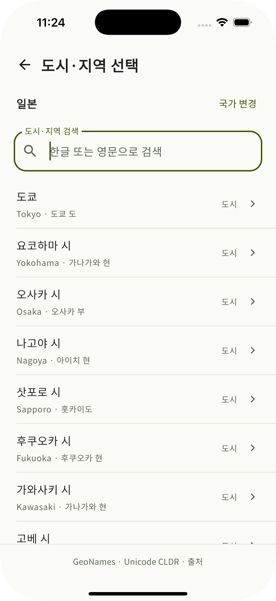
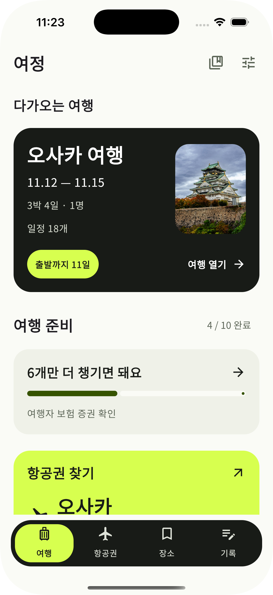
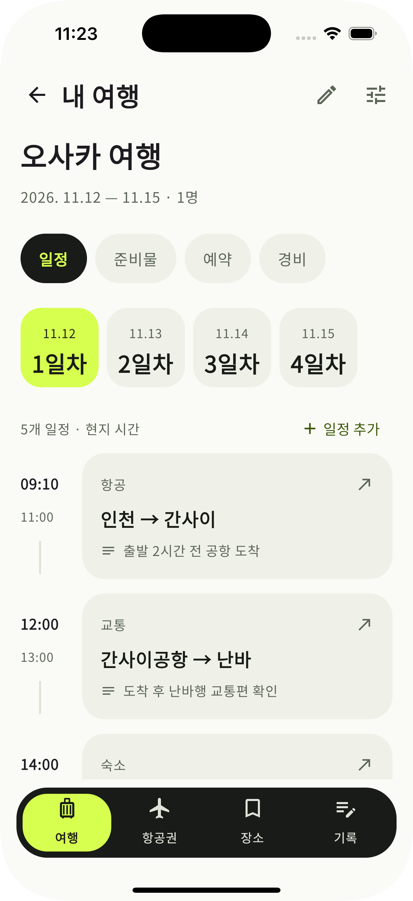

# 여정 — 기획 발표 핵심 구성

작성일: 2026-11-01 · 최종 7장 · 앱 실시간 시연 없음

[여정 기획 발표 수정본 PPTX](../../presentation/여정_기획발표_수정본.pptx) 제작을 완료했다. 실제 앱 화면 3개와 편집 가능한 도식·기술 비교표를 포함하며 발표자 노트·댓글·노트 파트는 없다.

## 1장 · 표지

**여정 — 여행 정보를 한곳에**

따로 찾던 일정과 예약서, 한 여행 안에서 확인합니다.

표지에는 라임 경로 아이콘이 있는 [로딩폰 디자인 콘셉트](../../presentation/assets/splash-phone.png)를 사용한다. 이미지 생성 도구로 만든 자산이며 실제 앱 시작 기능의 실행 증거가 아니다.

## 2장 · 목차

앱 소개 → 핵심 사용 흐름 → 기술 스택 → 전체 시스템 구조 → 현재 범위와 다음 단계

## 3장 · 앱 소개와 장점

**계획부터 기록까지, 한 여행 안에서**

- 대상: 여행을 직접 준비하는 개인 여행자
- 정보를 찾을 때: 여행별로 모아 확인
- 여행을 준비할 때: 남은 준비를 한눈에 확인
- 현지에서: 날짜별 일정과 메모 확인

## 4장 · 핵심 사용 흐름

### 목적지 선택

국가별 도시·지역 검색으로 목적지를 선택한다.

### 여행 홈

여행 정보와 남은 준비를 한 화면에서 확인한다.

### 날짜별 일정

날짜별 계획과 메모를 함께 확인한다.

세 이미지는 Simulator의 **Save Screen**으로 내보낸 실제 디스플레이 PNG다. 창·모니터·포인터 효과를 포함하지 않으며, 얇은 폰 외곽선만 PPT 도형으로 추가했다.

## 5장 · 기술 스택

**Kotlin 하나로 Android·iOS 앱과 서버 개발**

- KMP·Compose: 두 OS의 공통 로직·화면
- Ktor Client: 앱의 API 통신
- Kotlin·Spring Boot: 자체 서버 API
- 현재 JSON 저장 → 후속 PostgreSQL 전환

선택 기술을 라임으로 강조하고 비교한 대안을 함께 제시한다. Kotlin 중심 개발 방향을 선택 근거로 삼으며 실측하지 않은 성능 우열을 주장하지 않는다.

## 6장 · 전체 시스템 구조

**모바일 앱 ↔ 자체 REST API ↔ JSON·파일 저장**

- 현재: KMP·Compose → Ktor Client → Spring Boot → 로컬 저장
- 현재 외부 연결: Google 항공편·지도 화면으로 이동
- 후속: PostgreSQL·인증·동기화·지도 SDK·Gmail 연동
- 항공·숙소 공급사 API는 선정 전

PPT에서 앱·서버·저장소와 연결선을 편집할 수 있다. DB 아이콘은 단정한 스택 형태이며 연결선과 텍스트가 겹치는 곳은 배경 마스크로 정리했다.

## 7장 · 현재 범위와 다음 단계

- 현재: 여행·일정·메모·준비물·수동 예약·서류·경비·장소·기록
- 다음: 정보 찾기·입력 흐름의 사용성 확인
- 이후: 로그인·PostgreSQL·여러 기기 동기화
- 장기: 외부 API 선정 후 실제 예약·결제 확장 검토

폰트는 **맑은 고딕(Malgun Gothic)·Aptos**이며 Noto 글꼴을 별도로 설치할 필요가 없다. 사실 확인과 상세 설명은 [별도 설명 메모](04_대학발표_설명원고.md), 시각 기준은 [디자인 가이드](07_발표자료_디자인가이드.md)를 참고한다. 구현 범위는 [검증 기록](../VERIFICATION.md)을 따른다.
