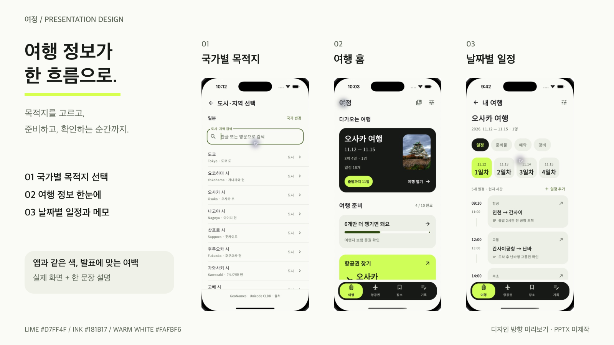
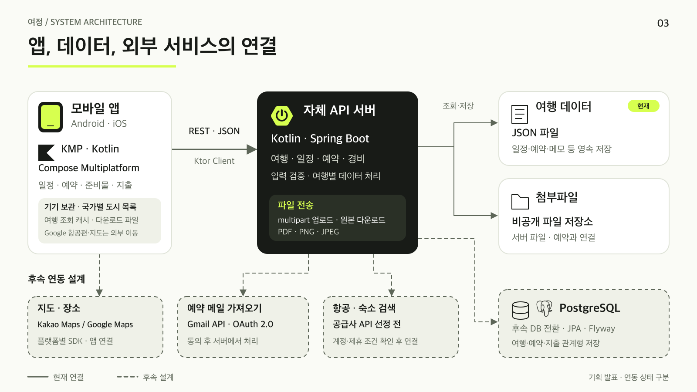

# 여정 — 발표자료 디자인 방향

**앱과 같은 브랜드, 발표에 맞는 넓은 여백.** 앱의 라임·잉크 블랙·둥근 형태를 가져오되, 슬라이드는 큰 제목과 짧은 설명으로 구성한다. 실제 앱 화면을 반드시 넣는다. 실시간 앱 시연과 PPTX 제작은 현재 범위에 포함하지 않는다.

## 시각 미리보기

[편집 가능한 SVG](assets/presentation-concept.svg). 디자인 방향을 확인하는 이미지이며 전체 발표자료는 아니다.

## 색과 형태

| 역할 | 색 | 적용 |
|---|---|---|
| 기본 배경 | `#FAFBF6` 웜 화이트 | 본문 슬라이드의 넓은 여백 |
| 제목·본문 | `#181B17` 잉크 블랙 | 제목, 도식의 중심 서버 카드 |
| 강조 | `#D7FF4F` 라임 | 핵심 단어, 짧은 선, 중요한 표시 |
| 보조 면 | `#EFF1E8` | 기능 묶음, 설명 카드 |
| 보조 글자·선 | `#5D6658` · `#DFE3D8` | 부연 설명, 구획선 |

표지는 어두운 배경과 라임 포인트, 본문은 밝은 배경을 기본으로 한다. 화면마다 새로운 강조색을 추가하지 않는다. 기술 로고도 단색으로 맞춰 앱 캡처의 색과 경쟁하지 않게 한다. 앱의 메뉴·버튼을 슬라이드 장식으로 반복하지 않는다.

## 실제 앱 화면

다음 세 장을 **국가별 목적지 선택 → 여행 홈 → 일정 확인** 순서로 배치한다. 캡처 비율을 유지하고 화면 안 문구나 데이터를 새로 합성하지 않는다.

| 화면 | 옆에 붙일 한 문장 |
|---|---|
| [국가별 도시·지역 선택](../screenshots/38-country-places.png) | 국가를 고르면 해당 국가의 도시·지역만 검색한다. |
| [여행 홈](../screenshots/01-home.png) | 여행 정보와 준비 상태를 한눈에 확인한다. |
| [날짜별 일정](../screenshots/02-schedule.png) | 날짜별 일정과 메모를 함께 확인한다. |

화면 세 장은 같은 높이와 간격으로 정렬한다. 작은 입력값까지 설명할 필요가 있을 때는 해당 화면을 크게 배치한 별도 구성을 사용한다. 화면 목록을 모두 나열하거나 실행 순서를 길게 설명하지 않는다.

## 시스템 구조도

[편집 가능한 SVG](assets/system-architecture.svg). 앱·서버·저장소에 역할 아이콘과 기술명을 함께 표시했다. PostgreSQL은 DB 도형과 브랜드 아이콘을 함께 사용한다.

- **실선:** 현재 앱·Ktor Client·Spring Boot·JSON·첨부파일 저장 연결.
- **점선:** PostgreSQL 전환, 지도 SDK, Gmail 가져오기, 항공·숙소 공급사 API의 후속 설계.
- 현재 항공권·지도는 외부 서비스 화면으로 이동한다. 공급사 API는 선정 전이며 계약·계정이 준비된 것으로 표현하지 않는다.

## 발표 편집 기준

16:9 비율을 사용한다. 제목은 30~36pt, 본문은 20~24pt를 출발점으로 실제 투사 환경에서 확인한다. 한 장은 하나의 메시지와 핵심 문장 3~4개로 구성한다. 기술 비교의 상세 내용과 검증 메모는 발표자 문서에 남긴다.

약 5장 구성은 [핵심 발표 구성](06_기획발표_핵심구성.md)을 따른다. 제작 계기는 ‘흩어진 여행 정보를 한 여행 아래 모으려는 기획 목적’으로 설명하며, 확인되지 않은 개인 경험이나 개선 수치를 추가하지 않는다.

## 도식 근거와 자산 출처

현재 연결은 저장소 소스와 [검증 기록](../VERIFICATION.md), 후속 구성은 [기술 선택 문서](03_기술스택_선정과_비교.md)를 기준으로 한다. 기능 지원 안내는 [Kakao Maps](https://developers.kakao.com/docs/ko/kakaomap/common), [Google Maps Platform](https://developers.google.com/maps/documentation), [Gmail API](https://developers.google.com/workspace/gmail/api/guides), [Room KMP](https://developer.android.com/kotlin/multiplatform/room) 공식 문서를 확인했다. 실제 계정 권한 확보나 연동 완료를 뜻하지 않는다.

Kotlin·Spring Boot·PostgreSQL 도형은 [Simple Icons](https://github.com/simple-icons/simple-icons)의 브랜드 아이콘을 사용했다. 원본과 라이선스는 [자산 출처](assets/ASSET_SOURCES.md)에 기록했다. 휴대전화·파일·폴더·DB 도형은 이 프로젝트의 구조 설명을 위해 직접 작성했다.
